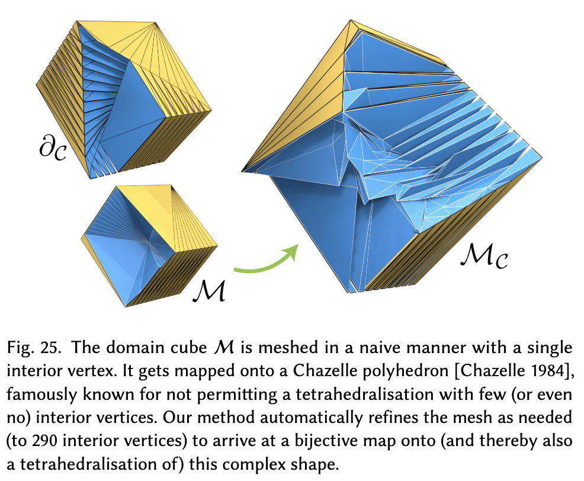

# Robust Deformation-based 3D Bijective Mapping through Differential Boundary Shape Matching

[Paper](https://www.algohex.eu/publications/deformation-maps/boundary-deformation-maps-sga-2026.pdf) | [DOI](https://doi.org/10.1145/3842573) | [Project page](https://www.algohex.eu/publications/deformation-maps/)


## Disclaimer

Most of the code evolved from a very different initial research direction, hence all the "Non-Conforming Meshes" business you'll find in the source code.
Hopefully I'll be able to make a new, better version in the future, but in the meantime, this will have to do.

Same thing for all the parameters found in `opti-parameters.json`; most of them are now deprecated. Hence the dedicated section below.

Don't hesitate to write to me at valentin.nigolian@gmail.com if you have any question.

## Building

Classic CMake business:
````
mkdir build-release && cd build-release
cmake -DCMAKE_BUILD_TYPE=Release ..
make -j
````

 Dependencies are downloaded with the `FetchContent` module.
The project can be used as a standalone (with the `cli/boundary_deformation_maps`main), or as a dependency (with `FetchContent` as well or `add_subdirectory`).


## Running

There are many options for the executable, so please run it with `--help` for an exhaustive list. A typical run looks like:

`./cli/boundary_deformation_maps -v2 -tet --domain-mesh path/to/domain/mesh.ovm --boundary-txt path/to/boundary/conditions.txt --output-domain-mesh-filepath path/to/output/domain/mesh.ovm --output-codomain-mesh-filepath path/to/output/codomain/mesh.ovm`

Alternatively, the codomain (target) mesh can be specified as a `.ovm` file, with `--codomain-mesh`.

`--output-(co)domain-mesh-filepath` arguments are optional, and the output meshes will be written in the executable's directory by default.

Same for the `opti-parameters.json` file (see below). It will read the one aliased in the executable directory by default, but you can specifiy the path with `--json-stats-filepath`.


### JSON Parameters

A lot of the parameters in the `opti-parameters.json` file are either deprecated or have limited impact. So here are the most important ones:

| name    | usage |
| -------- | ------- |
| `global_wrapping_quick_remeshing_target_quality_threshold`, `global_wrapping_deep_remeshing_inner_iters` and `global_wrapping_deep_remeshing_target_quality_threshold`  | Remeshing strategies parameters mentioned in Sec.4.5.3 of the paper    |
| `global_wrapping_virtual_element`  |  The choice of function $d(X)$ from the paper. Symmetric Dirichlet Energy (`AUG_SDE`) by default. Check out the code for more details. |
| `global_wrapping_virtual_energy_inner_progress_thresh` and `global_wrapping_virtual_energy_outer_progress_thresh`  |  progress thresholds from Sec.4.7 of the paper  |
| `global_wrapping_max_angle_diff_snap_thresh`  |  Angle threshold (in degrees) before entering the "snap phase"  |
| `global_wrapping_IVL_bound`  |  $\frac{1}{q_{min}}$ in the paper  |
| `global_wrapping_IVL_rel_vol_bound`  |  $v_{min}$ in the paper  |
| `global_wrapping_edge_length_bound_elements_boundary_rel_bound`  |  $l_{min}$ in the paper  |
| `enable_initial_mesh_decimation` and `enable_ref_mesh_pre_remeshing`  |  optional remeshing steps, as discussed in the paper. You can probably disable those if your source and target meshes are geometrically close.  |
| `log_level` | possible values are `debug`, `info`, `warning`, `important` and `error`. The default is `important`, allows to roughly follow what's happening, and `error` will run (mostly) silently.|
| `timeout_time_h` | Number of hours before the algorithm stops.|


Again, please do not hesitate to write to me in case you have a question.


### Virtual Elements Energy
By default, this is the Symmetric Dirichlet Energy. However, a lot of experimentation went into trying other options, or a mix of options. This will transpire in a few places throughout the code, notably the `run_global_wrapping()` function in `RemeshingOptimizerV2.cc`. Feel free to try different things. There's also a "backup mode" that only enables secondary or tertiary virtual elements energies when stuck. You can experiment with that using the `global_wrapping_enable_backup_DA_energy_mode` and `global_wrapping_adaptive_start_w_target_g_norm` parameters.


## Test Meshes

The `test-meshes` directory contains 15 meshes mapped onto difficult boundary conditions (those generated for the first Shrink-and-Expand paper). Feel free to try them out with different parameters.

e.g. `./cli/boundary_deformation_maps -v2 -tet --domain-mesh ../test-meshes/s04c_tetrahedron.ovm --codomain-mesh ../test-meshes/ball_mapped/s04c_tetrahedron.ovm`

### Chazelle Polyhedron

You will also find there a Chazelle Polyhedron in `.obj`format ($\partial_\mathcal{C}$ below), as well as its `.ovm` tetrahedralisation generated by our method ($\mathcal{M}_\mathcal{C}$ below).

More Chazelle Polyhedron can be generated with `cli/scripts/chazelle_polyhedron.py`, courtesy of Martin Heistermann.



